

<picture>
  <source media="(prefers-color-scheme: dark)" srcset="brand/final/lockup-horizontal-reversed.svg">
  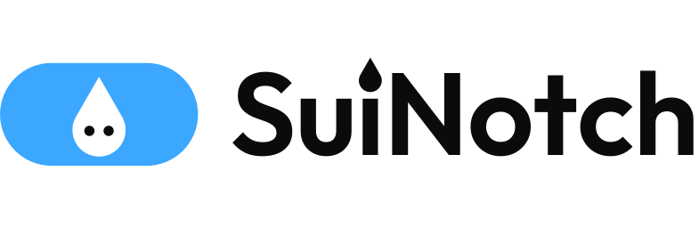
</picture>

### A living notch for the top of your Windows screen.

Music, lyrics, focus, water, tasks, files and your day, tucked into one small black pill
that opens when you need it and gets out of the way when you don't.

 

  

<a href="docs/media/showcase.mp4">
  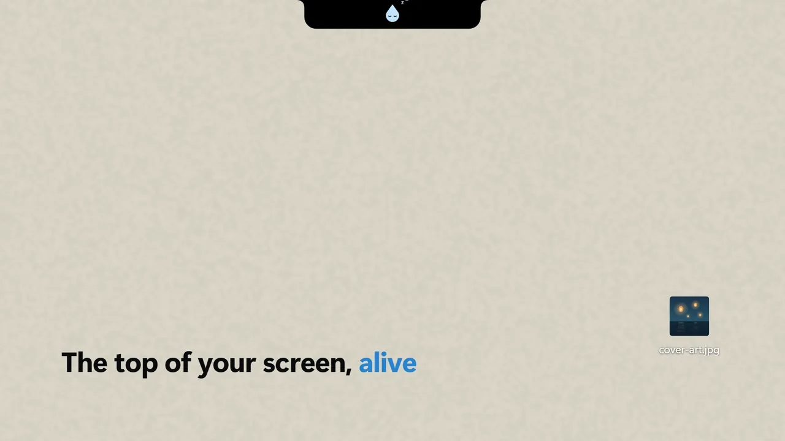
</a>

<a href="docs/media/showcase.mp4"><b>▶&nbsp; Watch the full showcase</b></a> &nbsp;·&nbsp; 45 seconds, with sound

 

## Meet Sui

<table>
<tr>
<td width="46%">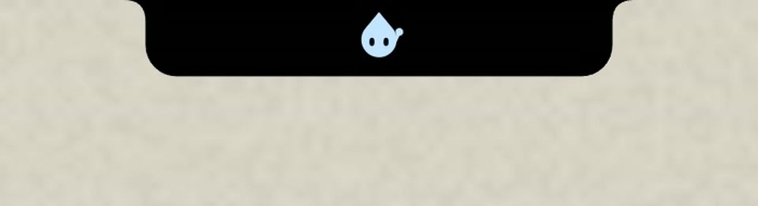</td>
<td>

**Sui lives in your notch.**

A little water drop who keeps you company while you're away. Sui dozes when the
screen is quiet, blinks now and then, and waves hello the moment you're back.

</td>
</tr>
</table>

 

## Everything, one glance away

<table>
<tr>
<td width="50%" valign="top">
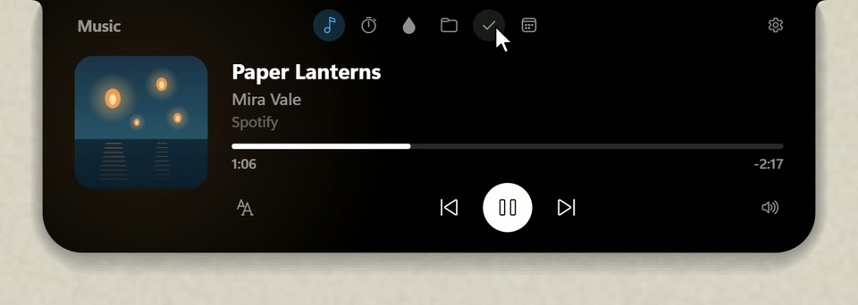
<h3>🎵 Music</h3>
Artwork, a seek bar, playback controls and volume for whatever's playing. While a song runs,
the closed notch shows its cover and a live equaliser.
</td>
<td width="50%" valign="top">
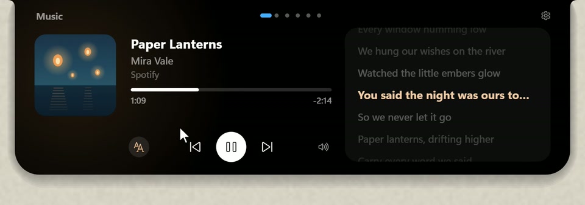
<h3>🎤 Synced lyrics</h3>
Lyrics follow the song line by line, inside the notch or in a small pill that floats
underneath it, so you can sing along without opening anything.
</td>
</tr>
<tr>
<td width="50%" valign="top">
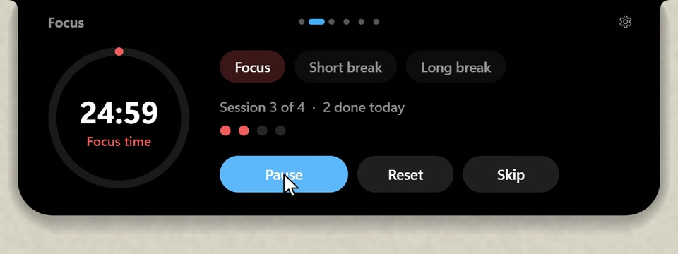
<h3>⏱️ Focus</h3>
A Pomodoro timer with focus sessions, short and long breaks, and a running count of
what you've finished today.
</td>
<td width="50%" valign="top">
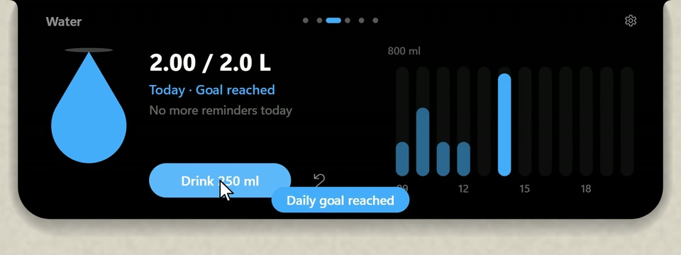
<h3>💧 Water</h3>
A daily goal, an hourly chart and gentle reminders. One click logs a glass, and the
notch lets you know when you've reached your goal.
</td>
</tr>
<tr>
<td width="50%" valign="top">
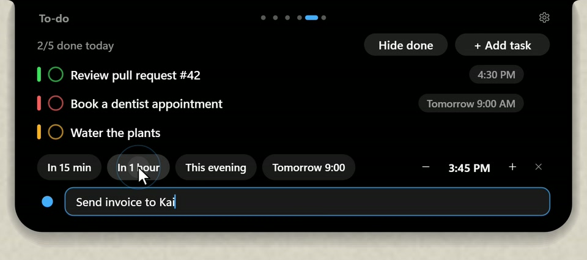
<h3>✅ To-do</h3>
Colour-coded tasks with due times, quick reminder chips, snooze and daily progress.
Add a task in a couple of keystrokes.
</td>
<td width="50%" valign="top">
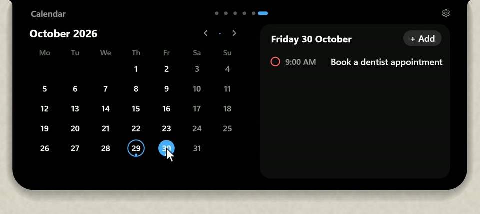
<h3>📅 Calendar</h3>
Your month at a glance, with dots on the days that have tasks and the day's agenda
right beside it.
</td>
</tr>
<tr>
<td width="50%" valign="top">
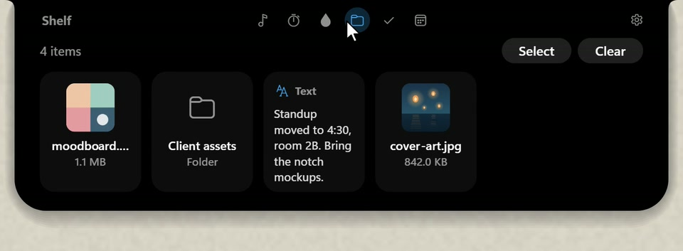
<h3>📂 Shelf</h3>
Drop files or text onto the notch to keep them close, then drag them back out
whenever you need them.
</td>
<td width="50%" valign="top">
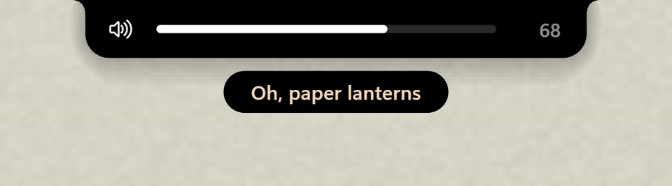
<h3>🔊 Overlays</h3>
Clean, compact pop-ups for volume, brightness, Caps Lock, keyboard language, battery,
Wi-Fi and headphones, right where your eyes already are.
</td>
</tr>
</table>

 

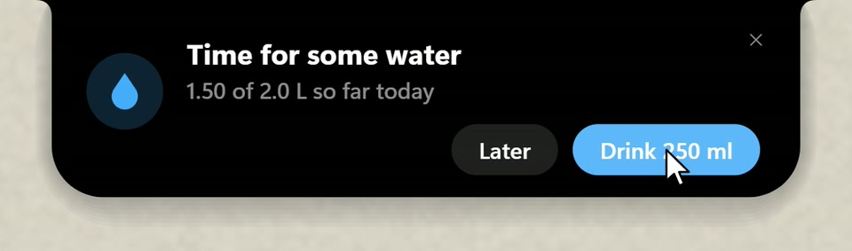
 
Reminders arrive in the notch itself, never in a pile of notifications.

 

## Made to feel native

<table>
<tr>
<td width="33%" valign="top">

#### 🌊 Fluid motion
Spring animations that run at your display's own refresh rate, from 60 to 165 Hz and beyond,
with barely any CPU.

</td>
<td width="33%" valign="top">

#### 🎨 Yours to tune
Size, display, accent colour, roundness and animation style. Every feature can be turned on
or off.

</td>
<td width="33%" valign="top">

#### 🔄 Always current
Updates install quietly while you're away from the PC, and a short "What's new" greets you
after each one.

</td>
</tr>
</table>

 

**SuiNotch** &nbsp;·&nbsp; Free for Windows &nbsp;·&nbsp; Made by CafeTako

<a href="LICENSE">MIT License</a> &nbsp;·&nbsp; <a href="PRIVACY.md">Privacy</a> &nbsp;·&nbsp; <a href="TRADEMARKS.md">Name &amp; logo</a> &nbsp;·&nbsp; <a href="THIRD-PARTY-NOTICES.txt">Third-party notices</a>

